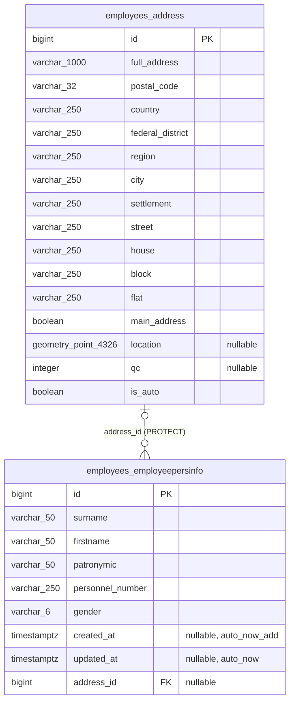

# OMS2 — ERD сущностей базы данных

Диаграмма отражает прикладные таблицы сервиса OMS2 по Django-моделям и миграции `OMS2/apps/employees/migrations/0001_initial.py`. Стандартные системные таблицы Django (`auth_*`, `django_*`) в диаграмму не включены.

## Примечания

- `employees_address` соответствует модели `Address`; `employees_employeepersinfo` — модели `Employeepersinfo`.
- `address_id` nullable: сотрудник может не иметь связанного адреса. Один адрес может быть связан с несколькими сотрудниками.
- `location` — PostGIS `PointField` с SRID 4326; поле nullable.
- `personnel_number` не имеет ограничения `UNIQUE` в текущей модели/миграции.
- Модели OMS2 — ORM-модели Django; эта диаграмма одновременно отражает их прикладную ORM-структуру и соответствующие таблицы.
- Схема live-БД не опрашивалась: namespace `oms` сейчас не содержит запущенных ресурсов. Диаграмма построена по исходным моделям и миграции репозитория.
