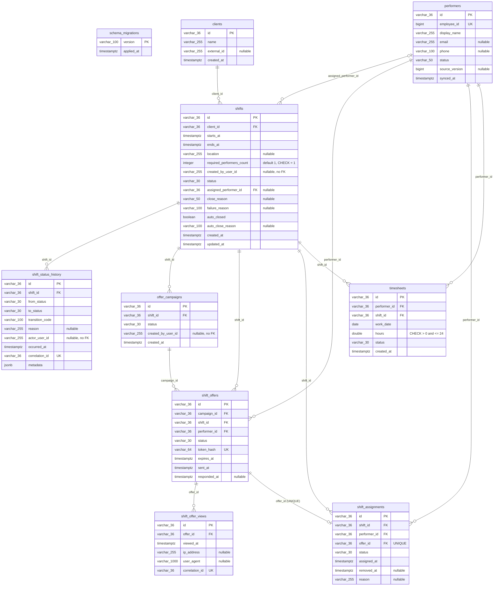

# OMS5 — ERD сущностей базы данных

Диаграмма отражает таблицы, создаваемые SQL-миграцией `OMS5/app/migrations/001_create_operational_state.sql`. OMS5 не использует ORM для хранения данных: доступ к PostgreSQL реализован SQL-запросами в `OMS5/app/storage.py`. Pydantic-модели в `OMS5/app/main.py` описывают API payloads и не являются ORM-сущностями.

## Ограничения и примечания

- `schema_migrations` хранит версию примененной SQL-миграции; бизнес-связей с остальными таблицами нет.
- Для `shifts` действует `CHECK (ends_at > starts_at)` и `CHECK (required_performers_count = 1)`.
- Для `shift_offers` задана уникальность `(campaign_id, performer_id)`; `token_hash` уникален.
- Для `shift_assignments.offer_id` задана уникальность. Дополнительно существует частичный уникальный индекс: одновременно может быть только одно назначение со статусом `assigned` на одну смену.
- Для `timesheets` задана уникальность `(performer_id, shift_id, work_date)`.
- Для `shift_status_history.correlation_id` и `shift_offer_views.correlation_id` заданы уникальные ограничения.
- `created_by_user_id` и `actor_user_id` — идентификаторы пользователей, хранящиеся без внешнего ключа на БД OMS1.
- Внешний ключ `performers.employee_id` на таблицу сотрудников OMS2 отсутствует: это идентификатор источника, а не межбазовая FK-связь.
- В миграции не объявлены ENUM-типы для статусов; они представлены строковыми колонками и ограничиваются логикой приложения.
- Схема live-БД не опрашивалась: namespace `oms` сейчас не содержит запущенных ресурсов. Диаграмма построена по SQL-миграции репозитория.
